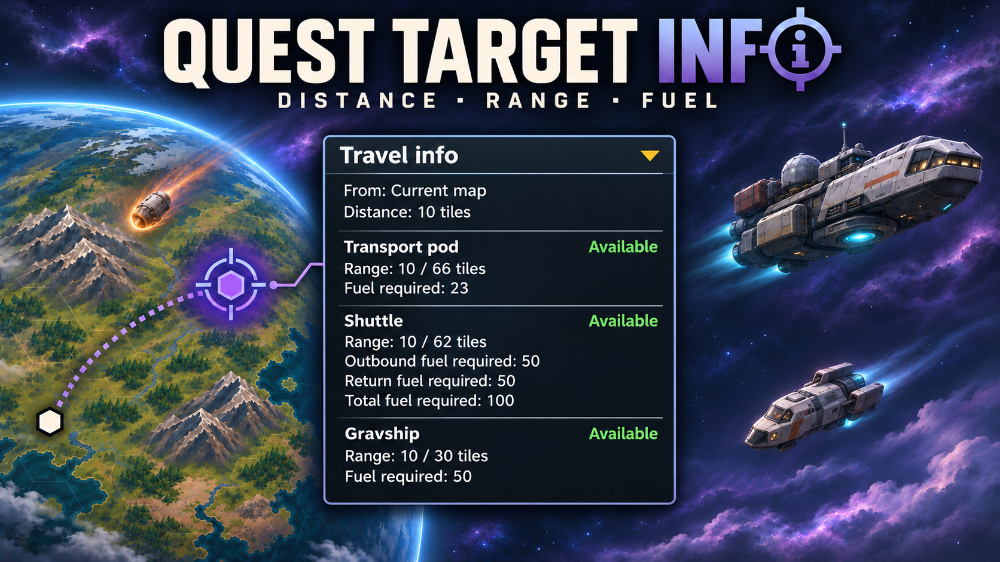

# [Quest Target Info](https://steamcommunity.com/sharedfiles/filedetails/?id=3541678897)



**Check distance, range and fuel before departure.**

Quest Target Info shows distance, flight range and estimated fuel requirements for world-map destinations in RimWorld. Check a quest target, select a world object or inspect an empty tile to compare transport options from the current map.

## Features

- A collapsible travel window for a selected quest with one world target.
- A **Travel** tab for selected world objects and empty world tiles.
- Flight distance and planet-layer context, including the current-map case.
- Transport pod, shuttle and gravship sections with range, fuel and relevant target restrictions.
- Separate outbound and return shuttle estimates, with warnings when the return trip is unavailable or out of range.
- Compact display, optional details and individual transport visibility settings.

## Requirements and installation

- RimWorld **1.6 or 1.7**.
- [Harmony](https://steamcommunity.com/workshop/filedetails/?id=2009463077), using a release compatible with your game version. Enable Harmony before Quest Target Info.
- Odyssey is optional. Shuttle and gravship information requires it.

Subscribe to the mod on [Steam Workshop](https://steamcommunity.com/sharedfiles/filedetails/?id=3541678897) and to Harmony, let Steam download both, then enable **Harmony** before **Quest Target Info** in RimWorld's Mods menu and restart as requested.

When building from source, use [deployment](#deploying-a-development-build) to prepare a complete installation. The repository's `mod/` directory and GitHub's automatic **Source code** archives contain shared content and a prebuilt DLL for RimWorld 1.6, but no DLL for RimWorld 1.7.

To update a manual installation, close RimWorld and replace the installed mod folder with the complete package. Replacing the folder prevents duplicate DLLs from an older installation; preserve personal files separately first. Steam handles updates for Workshop installations. Keep only one enabled copy and back up saves before updating.

To remove the mod, back up your save, disable the mod in RimWorld's Mods menu and restart the game before deleting the manual copy or unsubscribing. See [Compatibility](#compatibility) for version-specific save support and limitations.

## Usage

1. Load a colony map. That map is the origin for the displayed estimates.
2. Open **Quests** and select a quest with exactly one valid world target. Its travel window appears automatically when the setting is enabled.
3. Alternatively, open the world map, select one world object or an empty tile, and open **Travel** in the inspect pane.

Use the arrow in the quest window to collapse or expand it. Select another destination to compare its information. The mod displays estimates; it does not launch vehicles or plan a caravan route.

## Reading the estimates

Flight distance can cross impassable intermediate tiles. Destination restrictions and planet-layer connections are checked separately. Distance and range can differ between outward and return travel.

Transport pod and shuttle values use fixed vanilla reference values. They do not inspect a particular loaded pod or shuttle, its fuel or its cargo. Gravship information uses a spawned grav engine on the current map and its available fuel, range and signal jammer. A packed engine is not an available gravship.

Shuttle fuel values describe direct flights. An estimated launch count is a distance calculation, not a confirmed itinerary with intermediate landing sites, refuelling or fuel for every leg. Return warnings remain visible in compact mode; an unavailable return route does not hide an otherwise valid outbound flight.

## Settings

Open RimWorld's mod settings and choose **Quest Target Info**. You can enable the quest window and world inspect tab independently, hide individual transports, show unavailable transports, and enable the ancient pod compatibility and layer-adjusted distance lines.

All visibility options are enabled by default. **Compact mode** is off by default; enabling it hides secondary detail while keeping route and transport summaries. Settings are saved as mod settings and apply to the display without restarting the game.

## Compatibility

The behavior described here applies to vanilla world travel in RimWorld 1.7, with Core alone or optional Odyssey. The included 1.6 version provides quest-window and Travel-tab information, but does not receive the calculation and interface updates for 1.7.

On RimWorld 1.7, the mod can be added to an existing save or removed from a game saved with it enabled. Keep a backup before changing your mod list. The mod stores its options in mod settings and adds no persistent objects or definitions to saves. Updating the mod does not convert a 1.6 save to 1.7.

Other mods can change transport constants, destination rules or the patched quest and world-inspection interfaces. Custom transports and multiplayer have not been validated. Fixed pod and shuttle estimates may differ when another mod changes those mechanics. The game remains responsible for the actual launch and landing checks.

## Languages

- English
- German
- Russian
- Ukrainian

## Development

The source project targets `net10.0` and builds the RimWorld 1.7 DLL. The package also includes a prebuilt RimWorld 1.6 DLL, which must remain unchanged and must not be rebuilt from current sources.

### Prerequisites

- The **.NET 10 SDK**.
- A local RimWorld **1.7** installation supplying `Assembly-CSharp.dll`, `UnityStubs.dll` and `Waylith.dll`.
- The `0Harmony.dll` used by a Harmony installation compatible with RimWorld 1.7.

### Local configuration

Copy [QuestTargetInfo.Local.props.example](docs/QuestTargetInfo.Local.props.example) to `src/QuestTargetInfo.Local.props`, which is ignored by Git. If the local file already exists, update its values without overwriting the existing configuration.

- Set `RimWorldManagedDir` to the RimWorld 1.7 directory containing `Assembly-CSharp.dll`, `UnityStubs.dll` and `Waylith.dll`. On Windows, this is the game installation root.
- Set `HarmonyDllPath` to the full path of the `0Harmony.dll` supplied by Harmony for RimWorld 1.7.
- Leave `DeployToGame=false` for ordinary development. Configure `RimWorldModAssembliesDir` only for explicit deployment; it must identify the intended development installation's `Current/Assemblies/` directory.

### Build

From the repository root:

```powershell
dotnet build src/QuestTargetInfo.sln -c Release
```

The current DLL is written under `src/QuestTargetInfo/bin/Release/`. Use `-c Debug` for a Debug build in `bin/Debug/`. Ordinary builds leave `mod/` and the game installation unchanged. No current DLL is staged in source `mod/`.

### Deploying a development build

Set `RimWorldModAssembliesDir` to the absolute destination `<mod directory>/Current/Assemblies/`, using this casing. Close RimWorld before updating its installed mod, then run:

```powershell
dotnet build src/QuestTargetInfo.sln -c Release -p:DeployToGame=true
```

Deployment creates or updates the complete mod in the directory above `Current`. It copies shared content and the preserved historical DLL from `mod/`, writes the built `QuestTargetInfo.dll` to `Current/Assemblies/`, and installs `LoadFolders.xml` with the matching version selection:

```text
QuestTargetInfo/
  About/
  LoadFolders.xml
  Languages/   Shared translations
  1.6/Assemblies/QuestTargetInfo.dll   Preserved RimWorld 1.6 assembly
  Current/Assemblies/QuestTargetInfo.dll   Current build for RimWorld 1.7
```

The deployment rules are in [ModDeployment.targets](build/ModDeployment.targets). Before changing the destination, they validate its location, an existing package ID, the current load-folder mapping and the historical DLL checksums. A destination inside the source repository, its ancestors, the game root, another mod, or a path through symbolic links/junctions is rejected.

Deployment replaces the managed `About`, `Defs`, `Patches`, `Languages`, `Textures`, `Sounds`, `Resources`, `Common`, historical-version and `Current` directories. It also removes obsolete root `Assemblies/` and the numbered directory of the current game version (`1.7/` today). Files outside these directories are preserved; keep personal files there. A local `About/PublishedFileId.txt` is preserved when the source package does not supply it.

Use the deployed directory as the installable package. To prepare a complete installable folder, deploy to a clean external directory by overriding `-p:RimWorldModAssembliesDir=<absolute staging directory>/Current/Assemblies/`. A clean destination avoids including unrelated files preserved from a development installation. Game and Harmony reference DLLs and test assemblies are not copied.

`LoadFolders.xml` selects the shared root plus `1.6` for RimWorld 1.6, or the shared root plus `Current` for 1.7. When a future game version needs a different DLL, preserve the last compatible DLL in its numbered directory under `mod/`, add its `HistoricalModVersion` entry and SHA-256 in the production project, update `CurrentRimWorldVersion`, and update `LoadFolders.xml` and `About.xml` so the new version uses `Current`. Historical DLLs are never rebuilt from current source.

### Tests

```powershell
dotnet test tests/QuestTargetInfo.Tests/QuestTargetInfo.Tests.csproj -c Release
```

The NUnit suite tests project-owned calculations, return-trip results, cache behavior and window layout. The test project builds the production dependency with deployment disabled; game references needed by the test host stay in its output. See [Testing policy](docs/testing.md) for automated boundaries, package checks and in-game scenarios.

Deployment validation runs automatically when preparing the installed package or an external staging package. When changing its rules, exercise invalid inputs in a disposable source copy and external destination using the same deployment command. The [package-check scenarios](docs/testing.md#build-and-package-checks) describe expected rejection and replacement behavior.

## Technical documentation

- [Architecture](docs/architecture.md)
- [Testing policy](docs/testing.md)